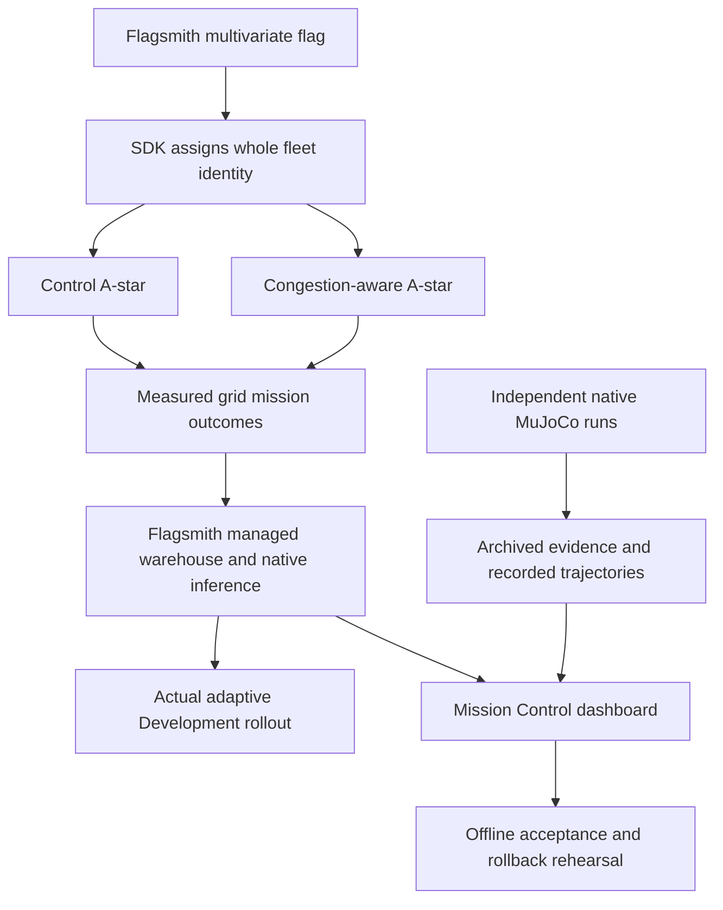

# RoboFlag — FeatureOps for Physical AI

**Experiment before you deploy. Measure before you scale.**

Built for the Flagsmith Experimentation Hackathon (Toggle Wars 2026) · Team AlphaBot · Track 01: Test Something Real

[](https://roboflag.vercel.app/) [](https://roboflag.vercel.app/physics.html) [](https://github.com/lalitkumar790/RoboFlag/actions/runs/45683353103)

RoboFlag brings feature experimentation to autonomous warehouse fleets. Instead of assuming a new navigation controller is better, we assign whole fleets through native Flagsmith experiments, measure mission completion, inspect native Bayesian results and make an explicit release decision. An independent MuJoCo validation framework explores physical dynamics, moving obstacles and deadline-constrained navigation.

## Results at a glance

| Achievement | Verified result |
|---|---:|
| Native mean mission completion | 67.00% → 97.17% |
| Native relative lift | **+45.02%** |
| Native winner probability (UI) | >99% |
| Final native experiment | 200 fleets / 2,400 simulated robot missions |
| Actual winning variant rollout | **100% adaptive in Flagsmith Development** |
| Frozen moving-cart physical holdout | 148/168 → 168/168 completed |
| Total evaluated mission attempts | 10,872 (6,960 grid + 3,912 physical) |

Mission attempts include comparative reruns and repeated assignments, not 10,872 independent observations. No physical hardware deployment or safety certification is claimed.

## Try the live demo

- **[Mission Control](https://roboflag.vercel.app/)** — grid replay, finalized native results and offline rollout rehearsal.
- **[3D Physical Mission Control](https://roboflag.vercel.app/physics.html)** — synchronized 6-, 12- and 24-robot replay, orbit/zoom, playback and timeline scrubbing, frozen benchmark evidence and release decision panel.
- [Native experiment #445](https://app.flagsmith.com/project/55942/environment/ct79ji5uxYHWDuaENkDRHr/experiments/445) (Flagsmith account access required). Public evidence is archived in this repository and displayed on Mission Control.
- [Demo narration](docs/demo.md) · [Submission handoff](docs/submission.md). Video link pending recording.

## Why Flagsmith is essential

Flagsmith Cloud's Experimentation product is the core of the native workflow, not just an on/off switch.

| Flagsmith capability | RoboFlag implementation |
|---|---|
| Multivariate feature flag | `fleet_navigation_experiment` |
| SDK identity assignment | One unique identity per fleet; all 12 robots use the assigned policy |
| Native experiment | Control `control` vs keyed adaptive variant `congestion_aware` |
| Managed warehouse and outcome events | Measured mission completion fraction from each simulated fleet |
| Bayesian inference | Native relative lift, credible interval and chance to win |
| Experiment completion | Actual published Development variant allocation of 100% |

Whole-fleet randomization avoids mixing interacting treatment and control robots within a single fleet. The physical research is separate: it does not send Flagsmith experiment traffic.



## Final native experiment #445 — completed

Fresh prespecified seeds 3000–3199; 200 unique fleets, 12 robots per fleet; 50:50 planned split and exactly 100 observed identities per arm. Primary metric 405: mean fleet mission completion rate.

| Metric | Control A* | Adaptive congestion-aware A* |
|---|---:|---:|
| Fleet identities | 100 | 100 |
| Successful robot missions | 804/1,200 | 1,166/1,200 |
| Mean fleet completion | 67.00% | **97.17%** |
| Fully completed fleets | 3/100 | 78/100 |
| Blocked proposals | 38,217 | 3,826 |

**Absolute improvement:** +30.17 percentage points. **Relative lift:** +45.02%. Native 95% credible interval for relative lift: +37.58% to +52.47%. Flagsmith UI reports >99% winner probability (API model output 1.0); this is not physical certainty. Native SRM is unavailable; observed allocation is balanced.

Completed November 26, 2026 IST. Native results are finalized (`is_final: true`); rollout decision `variant`, variant ID 36620 (`adaptive`), actual published Development allocation **100%**, independently verified through the feature version API. No new experiment traffic or Flagsmith Production change.

**Evidence:** [Final native API archive, including previous snapshot and published feature state](roboflag/experiment_445.json) · [Original 200 fleet records](evidence/experiment_445_fleets.jsonl).

### Earlier native experiment #442 — retained for transparency

The earlier primary endpoint was all 12 robots completing their missions: control 2/88 fleets (2.27%) versus adaptive 88/112 (78.57%), absolute lift 76.30 percentage points. Individual completions 662/1056 vs 1312/1344. Independent Fisher exact two-sided p = 2.0681e-31; native inference was unavailable at capture (only two control conversions). #442 completed with control retained. #445 is a fresh numeric follow-up, not a replacement of this original endpoint.

[Native #442 archive](roboflag/experiment_442.json) · [Original fleet outcomes](evidence/experiment_442_fleets.jsonl).

## Independent native MuJoCo research

Wheel-driven simulated robots navigate warehouse racks and a prescribed moving cart. The browser replays measured planar positions and headings with approximate 3D geometry; it does not run live MuJoCo physics.

| Frozen evaluation | Reference | Candidate | Decision |
|---|---:|---:|---|
| Static racks | V2 146/168 | V4 168/168 | Prefer V4 |
| Moving cart | V2 148/168 | V4 168/168 | Prefer V4 |
| Conditional reversal penalty | V4 168/168 | V5b 168/168 | Mixed efficiency |
| Deadline stress | V4 303/324 | V5b 301/324 | Retain V4 |
| Deadline stress | V4 303/324 | V6 302/324 | Retain V4 |

All listed holdouts registered zero external contact episodes and tracking failures in both arms. The deadline holdout shares the same reference arm in the last two rows; do not count it twice. V4 is the preferred **physical research** controller, distinct from the Flagsmith adaptive V2 policy.

The 24-robot demo (seed 4700) shows V2 completing 16/24 and V4 completing 24/24. This is one illustrative scenario, not the whole benchmark.

### Negative results are part of the evidence

- V3 heading-aware planning exhibited livelock and excessive reversals.
- V5's fixed reversal penalty reduced completion from 114/114 to 113/114 in development.
- V5b improved some efficiency measures but did not establish overall independent efficiency superiority.
- V6's deadline-aware heuristic helped one exploratory stress case but did not beat V4 on the frozen deadline holdout.

The dashboard rejects weaker candidates and separately demonstrates an offline fault-triggered rollout rehearsal (10% → 0% on failure; normal stages 10/25/50/100%). This is not a remote rollback. The #445 Development rollout is real.

[Research protocol and historical milestones](docs/physics-validation.md) · [Static holdout](evidence/physics_static_holdout.json) · [Moving-cart holdout](evidence/physics_dynamic_holdout.json) · [Deadline holdout, all 54 summaries](evidence/physics_v6_holdout.json).

## Reproduce locally — no credentials needed for offline evaluation

Python 3.10+; Python 3.12 was used for native physics CI. From the repository root:

```sh
git clone https://github.com/lalitkumar790/RoboFlag.git
cd RoboFlag
python -m venv .venv
```

Activate the virtual environment (PowerShell: `.\.venv\Scripts\Activate.ps1`; Linux/macOS: `source .venv/bin/activate`), then:

```sh
python -m pip install -r requirements.txt -r requirements-physics.txt
python -m pytest -q
python -m roboflag.benchmark --seeds 20 --robots 12
python -m roboflag.validation
python -m roboflag.export_dashboard
python -m roboflag.export_physical_evidence
python -m roboflag.export_physical
python -m http.server 8000 --directory dashboard
```

Open [http://localhost:8000](http://localhost:8000) or [http://localhost:8000/physics.html](http://localhost:8000/physics.html). Physical replay export runs the native engine; it can take longer than exporting archived statistics. For grid-only viewing, install requirements.txt and run export_dashboard and the HTTP server.

For a **new** native experiment in your own Flagsmith environment, see [Flagsmith setup and SDK procedure](docs/native-experiment.md). Never commit credentials or rerun completed experiment IDs or their confirmatory identities.

## Technology and evidence

Python, Flagsmith SDK 6.7.0, Flagsmith Cloud Experimentation, MuJoCo 3.3.7, NumPy, HTML/CSS/JavaScript, GitHub Actions and Vercel.

- [Final native evidence production regression](https://github.com/lalitkumar790/RoboFlag/actions/runs/45683353103)
- [Physical renderer browser validation](https://github.com/lalitkumar790/RoboFlag/actions/runs/45564388803)
- [Frozen deadline benchmark CI](https://github.com/lalitkumar790/RoboFlag/actions/runs/45509923670)

Research coverage: 2,160 offline grid attempts + 4,800 native grid experiment attempts + 3,912 physical fleet attempts = 10,872. Regenerated demo traces and isolated physics smoke tests are excluded. Counts include repeated assignments and comparative reruns.

## Limitations and next steps

Simulation parameters are provisional, the moving obstacle schedule is known, fleet movement arbitration is conservative, and actuator mechanical work is only a proxy rather than battery energy. Zero observed contacts in these benchmarks does not establish real-world safety. Future work: hardware-calibrated dynamics, unknown obstacle sensing, asynchronous fleet coordination and controlled physical deployment. The hosted dashboard serves archived evidence, not live robot telemetry.

## Acknowledgements

Powered by **Flagsmith Experimentation**. Thanks to Flagsmith and WeMakeDevs for Toggle Wars. RoboFlag demonstrates how feature experimentation and measured release decisions can extend beyond digital products into Physical AI.
