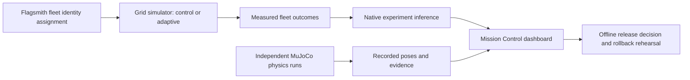

# RoboFlag — FeatureOps for Physical AI

Experiment before you deploy. Measure before you scale.

RoboFlag uses native Flagsmith experiments to evaluate robot fleet navigation policies in a seeded grid warehouse simulator. Whole fleets are randomized to avoid within-fleet interference.

## Try the application

- [3D physical mission control](https://roboflag-e5jxeyg6z-lalitsikarwar2001-6516s-projects.vercel.app/physics.html) — validated preview; Vercel sign-in may be required.
- [Native experiment dashboard](https://roboflag-e5jxeyg6z-lalitsikarwar2001-6516s-projects.vercel.app/) — actual Flagsmith snapshots, grid replay and offline rollout rehearsal.
- [Passing renderer CI](https://github.com/lalitkumar790/RoboFlag/actions/runs/45560797100) · [passing regression CI](https://github.com/lalitkumar790/RoboFlag/actions/runs/45560797207).
- [Demo narration](docs/demo.md) · [submission handoff](docs/submission.md).

## How it works



The native experiment and physical research are separate evidence streams. The browser plays measured poses, not live MuJoCo physics. The physical release gate and grid rollback rehearsal do not mutate Flagsmith.

## Independent physical validation

| Frozen campaign | Reference | Candidate |
|---|---:|---:|
| Static racks, V2 vs V4 | 146/168 | 168/168 |
| Moving cart, V2 vs V4 | 148/168 | 168/168 |
| Deadline stress, V4 vs V5b | 303/324 | 301/324 |
| Deadline stress, V4 vs V6 | 303/324 | 302/324 |

V4 remains the preferred physical controller. V3 exhibited livelock, V5 reduced reliability, and V5b/V6 did not establish superiority. See [physical validation protocol](docs/physics-validation.md) and [complete V6 holdout](evidence/physics_v6_holdout.json). Total research attempts: 10,872 (6,960 grid, 3,912 physical), including repeated assignments and comparative reruns, excluding regenerated display traces. These are not independent robot-level observations. No hardware safety certification.

For the 3D replay, install the pinned MuJoCo engine and generate the measured pose data before serving:

```sh
pip install -r requirements-physics.txt
python -m roboflag.export_dashboard
python -m roboflag.export_physical_evidence
python -m roboflag.export_physical
python -m http.server 8000 --directory dashboard
```

Open http://localhost:8000/physics.html, select 24 robots and scrub the synchronized timeline. Seed 4700 yields V2 16/24 versus V4 24/24. Camera drag, shift-drag, wheel zoom and top view are supported. Browser geometry approximates the physical model.

## Confirmatory experiment #442

200 unique fleets, 12 robots each, seeds 2000–2199. Primary endpoint: every robot completes its mission.

| Outcome | Control A* | Congestion-aware A* |
|---|---:|---:|
| Native exposures | 88 | 112 |
| Native complete-fleet conversions | 2 | 88 |
| Complete fleet success | 2.27% | 78.57% |
| Individual mission completion | 662/1056 | 1312/1344 |
| Blocked proposals per fleet | 433.00 | 36.29 |

Primary absolute lift: 76.30 percentage points. Independent two-sided Fisher exact p = 2.0681e-31; exact binomial allocation p = 0.103639. Native inference was null at capture. Counts are native API aggregates reconciled with local terminal outcomes, not synthetic conversions. See [API snapshot](roboflag/experiment_442.json). Experiment subsequently completed with control retained. Adaptive was the measured candidate, not the deployed winner. The preserved API results snapshot predates completion and is not marked final by Flagsmith. No further traffic planned.

## Reproduce

Python 3.10+:
```sh
pip install -r requirements.txt
python -m pytest -q
python -m roboflag.benchmark --seeds 20 --robots 12
python -m roboflag.validation
python -m roboflag.export_dashboard
python -m http.server 8000 --directory dashboard
```

[Mission Control deployment](https://roboflag.vercel.app) — static simulator traces, native snapshot and offline rollout rehearsal. Signed-out access must be checked before submission. See [experiment procedure](docs/native-experiment.md). Never commit credentials or rerun the confirmatory seeds against the same experiment.

## Evidence and limits

480 exploratory missions plus 1,680 density-validation missions and 2,400 confirmatory missions. Offline staged rollout rehearsal includes injected acceptance failure and a rollback recommendation, not a remote mutation. The grid simulator uses conservative movement arbitration; blocked proposals are not physical collisions. No hardware safety claim; high-density complete-fleet reliability remains limited. Native inference unavailable at capture. Browser and Python tests run in CI.

## Numeric follow-up #445
Prespecified fresh seeds 3000–3199; 200 fleets, 100 per arm, 2,400 simulated missions. Native metric 405 mean completion: 67.00% control vs 97.17% adaptive; native relative lift +45.02%, 95% credible interval +37.58% to +52.47%, reported chance to win 100%. Native SRM is null; observed allocation is balanced. Both numeric moments and counts reconcile with the archived original records. The reported probability is model output, not physical certainty. Completed 26 November 2026 IST: native results finalized, adaptive selected, published Development feature version verified at 100% adaptive allocation. No physical deployment claimed. No further traffic planned. Combined offline and two native experiments: 6,960 missions.
